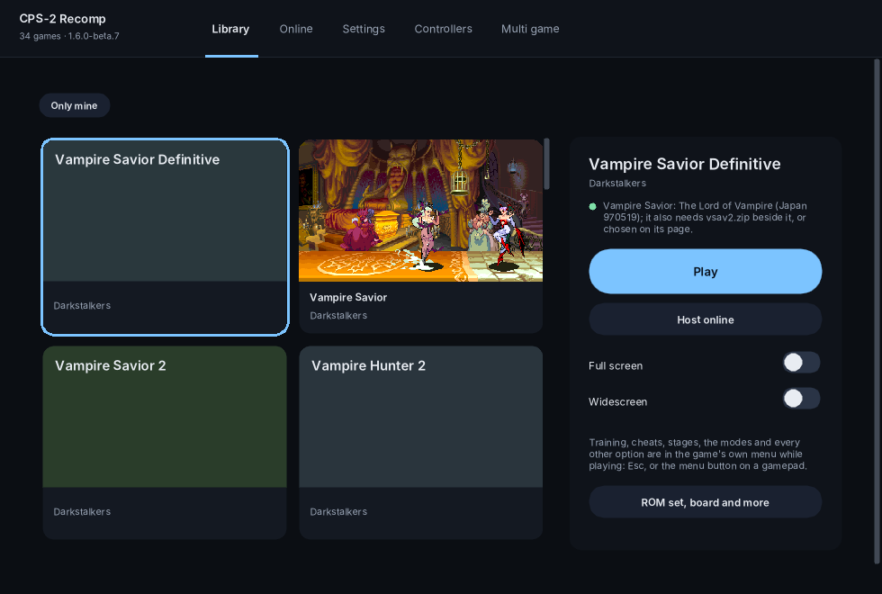
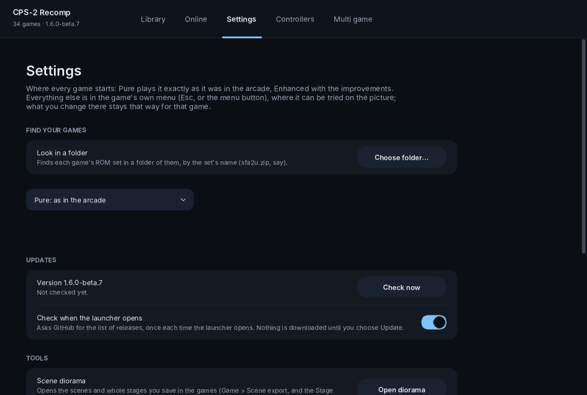

# The launcher

## Its pages



The launcher has the in-game menu's look: its pages are tabs along the top (Library, Online, Settings, Controllers,
Multi game; a gamepad's LB and RB go through them). The **Library** has your games as a grid of pictures: each
game's last screen when you quit it (else your newest screenshot of it, else its name). The game chosen is beside
them: Play, Host online, Full screen and Widescreen, and **ROM set, board and more**, its own page (its ROM set, the
board's own settings such as difficulty and continue, set for that game alone, and its place in the list). Press a
game's picture once to choose it and again (or Play) to play it. Above the grid, **Only mine** leaves out the games you
have no ROM set for.

The launcher has only what has to be set before a game starts. **Settings** has where the games start (Pure, as the
arcade, or Enhanced), the window's size, how the picture is drawn, VSync, the arcade monitor's mode, finding your ROM
sets (**Choose folder…**), updates and the language. **Controllers** sets the keys and buttons for every game (its
Layout for chooses a game, and Its own layout gives that game its own), and has **Keyboard only** for JoyToKey and
other keyboard mappers. Everything else (training, the modes, cheats, stages, shaders, the online readouts, capture)
is in each game's in-game menu, where it can be tried on the picture.

A release that ships its sets beside the launcher — a `roms` folder of zips — has them found when it opens: each
game whose set is there has it chosen for it, after the game's own check of it, and nothing is moved. A zip that is
named for no game is found by the files in it.

The games are in your order: **Move up** and **Move down** on a game's own page.



## Updates

When the launcher opens it asks GitHub for this project's releases (the Updates card, on the Settings tab, has a
switch to stop that, and **Check now**). When there is a newer version it shows there: **What's new**
opens its notes, and **Update** downloads the new version's download for your system (the same file as on the
releases page), checks it and every file that changed against the release's list, and only then
puts them all in place; if anything goes wrong nothing is changed. The launcher then starts again as the new
version. Your settings, save states and ROM sets are not touched. Quit the games first: Update waits until none is
running. A beta is offered only to a beta.

The launcher needs to be able to write to its own folder: on macOS, move `CPS-2 Recomp.app` to Applications (or
anywhere of your own) before opening it the first time, not run it from the downloaded zip's folder. A copy built
from source is told of a new version but not changed.

## Portable mode

To keep everything with the launcher (on a USB stick or an external drive you take from one computer to another),
put an empty file named `portable.txt` beside it:

| System | Where `portable.txt` goes | Where your things then are |
| --- | --- | --- |
| Windows, Linux, Steam Deck | in the `CPS2Recomp` folder, beside `cps2recomp-launcher` | `CPS2Recomp/user/` |
| macOS | in the folder `CPS-2 Recomp.app` is in (not inside the app) | `user/` in that folder |

Settings, save states, each board's settings memory, custom colours, the score attack records, a soundtrack in
the game's own folder and the logs then go in `user/`, a folder for the launcher and one for each game, laid out
as in your user folder. The launcher's Settings tab shows where they are under **Your files** (**Show** opens the
folder).

- **The first time**, if your user folder already has the games' things, the launcher asks whether to copy them
  to `user/`. Copying never takes anything from your user folder and never writes over a file.
- **To stop**, take `portable.txt` away: the launcher uses your user folder again, as it was when you started
  portable mode. Nothing is moved either way; to carry things back, copy the folders in `user/` to your user
  folder yourself (with the launcher closed).
- **Updates** keep `portable.txt` and `user/`: they change only the release's own files.
- **The folder has to be one you can write to.** If it is not (a read-only drive, or Windows' Program Files), the
  launcher says so and stops rather than keep your things somewhere else.
- ROM sets are still only read, wherever they are. A ROM folder chosen on a drive letter (Windows) or a mount
  point (`/Volumes/...`, `/media/...`) is remembered as that path: on another computer, choose it again if the
  drive is somewhere else. A Steam shortcut (**Add to Steam**) is for the computer it was added on.

## From a terminal

```sh
cps2recomp-launcher --play sfa2                 # straight into a game, as the launcher has it set
cps2recomp-launcher --play sfa2 -- --features widescreen,no_damage
                                                # with more arguments for the game, after the launcher's own
cps2recomp-launcher --page vampire_savior       # the launcher, at a game's page
sfa2 --rom ~/roms/sfa2u.zip --settings my.ini   # a game's own program (beside the launcher), by itself
sfa2 --soundtrack ~/music/sfa2-arranged          # a custom soundtrack's folder (with the feature on)
sfa2 --help                                     # what a game's program takes
```

The games' ids are `ssf2t`, `sfa`, `sfa2`, `sfz2al`, `sfa3`, `pocket_fighter`, `msh`, `xmvsf`, `mshvsf`, `mvsc`, `puzzle_fighter`, `dstlk`, `nwarr`, `vampire_savior`, `vsav2`, `vhunt2`, `vsav_definitive`, `avsp`, `dino`, `punisher`, `sf2ce`, `sf2hf` and `ghouls`. `--features` may be given more than once, and
a later one wins.

## Coming from a game's own download

Earlier releases came one game at a time (Street Fighter Alpha 2 Recomp, Vampire Savior Recomp). This launcher
keeps each game's settings, save states and board memory in the same folder as before, and takes the ROM set you
chose in a game's own launcher, so everything carries on. A game's own release still works.
