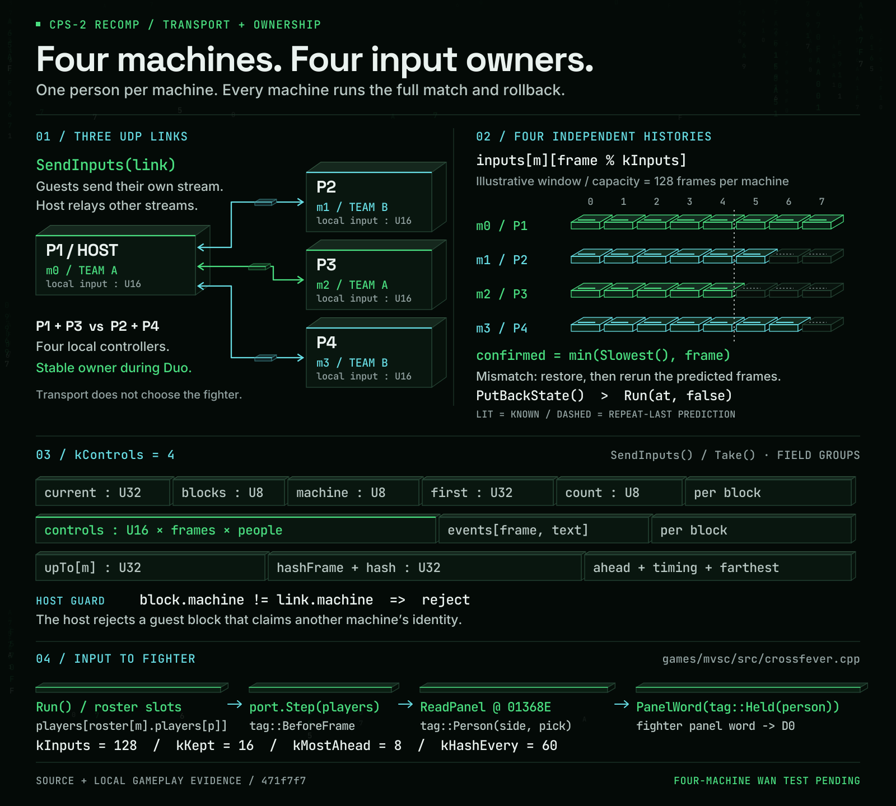

# Online play

Two players, each on their own machine, play a match with **rollback** netcode; in the tag-team games, four players on
up to four machines. Any mix of macOS, Linux, the Steam Deck and Windows can play each other.


## Starting a match

Each player needs the game and its ROM set. The launcher's **Online** page (in the sidebar) has it all, from the top
(its lists update every 3 seconds):

- **Discord**: where the players meet, find matches and tell us what to fix.
- **Online matches**: the matches other players are hosting in the lobby, in every game, each with **Join** (or
  **Watch**, for one under way: [watching a match](#watching-a-match)). No code is needed. A match in a
  game whose ROM set you haven't added is greyed, with **Add…** to add it.
- **Host a match**: choose a game and press **Host**, with the match's **Set format** (Casual, FT3, FT5, FT10) under it. The game shows the match's code to give the other player (the
  other three, in a match of four: they all join with it). If you've set **Your name**, the match is also listed in
  the lobby under it while places remain (and watchable after it starts, if spectators are allowed); without a name,
  only those you give the code to can join.
- **Waiting room**: you first, saying whether the others see you (ready to play, once you have a name), then the other
  players whose Online page is open now, under their names. Choose a game and press
  **Invite** next to someone: your game starts and hosts a match, and they see the invitation on their Online page,
  naming you and the game, with **Accept** and **Decline** (and **Add…** if they haven't that game's ROM set). Accept
  starts their game and joins yours; your game's wait says if they declined. You're in the waiting room while your
  Online page is open and you've set **Your name**, unless you switch off **Let others invite me**. An invitation never
  interrupts a game: it waits on the Online page. **Block** (on a player or an invitation) hides the two of you from
  each other; **Unblock all** undoes it. Nobody's address is shown, only names.
- **You** (at the bottom): your name, your country's flag, Let others invite me, and the players you blocked.
- **Join with a code** (folded under it: *Have a code for an unlisted match?*): only for a match its host kept out of
  the lobby. Type the code and press **Join**; the launcher starts the game the match is in.
- **Host from the game**: playing a game on your own, open its menu (Esc), go to **Online** and choose **Host a
  match**. Your game stays exactly your own while you wait: modes, training, cheats, the menu, save states, pause. The
  bottom of the screen says HOSTING with the match's code, and with a name set on the launcher's Online page the match
  is in the lobby too. When someone joins, the game starts over from the title for the match, with the match's
  settings. After the match you're back to your own settings and still hosting with the same code (unless you left
  the match yourself). The menu's row, now **Stop hosting**, stops it.
- **Arcade while waiting** (a switch under Host a match): play the game on your own while you wait, as at the arcade.
  The match's code and "WAITING FOR A CHALLENGER" show at the bottom of the screen. When someone joins, they come
  into your game as it is and press Start to challenge you. Esc asks whether to stop hosting.

All players and viewers need the **same version and build** of CPS-2 Recomp; the launcher shows its version at the
top of the sidebar. This version uses protocol 16 (each player's run-ahead said for the network stats, and Casual's score). All playing
machines and viewers need the same build even when two downloads display the same release number.
A match on another version is greyed in Online matches, and a code for one says so. Your ROM sets can be different
regions of the same game (`mvscj` against `mvsc`, say): the match is played as the host's region. That is best
effort: if the game reads a part of its program where the two sets still differ, the match stops as a desync does
(the same set is surest).

Each game's own page has the same under Play, in its **Online** card. Codes try a direct connection without router
setup; networks that block it need one of the alternatives below. The
host is player 1. The game's window says it is waiting until the other player comes, or how many more a match of four
waits for (Esc gives up). From a terminal:

```sh
cps2recomp-launcher --play sfa3 -- --host                  # the host: shows a code, waits for the other player
cps2recomp-launcher --play sfa3 -- --host --net-arcade     # ... playing the game meanwhile
cps2recomp-launcher --play sfa3 -- --join CODE             # the other player: the host's code (or address)
cps2recomp-launcher --play mvsc -- --host --features tag_team=2,cross_fever --net-people 1
cps2recomp-launcher --play mvsc -- --join CODE --net-people 1   # run on each of the other three machines
```

**Hosting by code without a public listing.** In the game settings, turn on **Online → Unlisted match** before hosting.
Your nickname still appears to the players you invite. Share the code or host address with them. The code admits anyone
who has it. Direct address hosting with `--net-service off` bypasses the service altogether.

**Your input delay.** Each player chooses their own, as on Fightcade: it holds back that player's own controls, in
every match they host or join, and the other player's choice is theirs. An explicit `--net-delay N` wins, including
zero. Next comes the game's **Online → Your input delay** choice (0–8 frames). **Use launcher setting** uses the
launcher's saved **Input delay**, or two frames if none was saved. The launcher's Online card shows the global
setting. A numeric choice for this game overrides it. Each machine says its delay as it joins, and it holds for the
whole match. A larger value adds your own response time and gives the other machines more time to receive your
inputs: fewer of your moves are corrected on their screens. For a distant group, compare the same route and match with two delay settings and record
the ping, correction count and waiting ticks. A single ping reading cannot identify jitter or the slow peer.

**Input during network waits.** In the game's **Online** settings or the in-match menu, each player can choose
how this machine samples its controllers. **Retain short taps** (default) keeps recent changes observed while
the simulation is waiting. When the simulation advances, it takes one saved controller state per new frame, in
order. A button can therefore register after you have let it go, even if the fighter's facing or ability to act
has changed. **Current state** uses the controls held at the instant each new frame advances. A tap entirely
inside the wait can disappear. Both choices apply your normal input delay. A saved replay uses the inputs
that were actually submitted. During a playtest, record the local choice alongside each player's delay.

## Choosing the MVC team layout

In the launcher's game settings open **Marvel vs. Capcom → Alternative modes**. The host chooses **Tag team** before
hosting. Every machine with one player selects **People at this machine → 1**, including a solo owner of two fighters.

| Humans | Tag team choice | Left team | Right team |
|---|---|---|---|
| 2 playing against one another | Off | P1 owns both | P2 owns both |
| 2 on the same team | Co-op vs. computer | P1 and P2 | CPU |
| 3 | 2 vs 1 | P1 and P3 | P2 owns both |
| 3 | 1 vs 2 | P1 owns both | P2 and P3 |
| 4 | 2 vs 2 · P1/P3 vs P2/P4 (default) | P1 and P3 | P2 and P4 |
| 4 | 2 vs 2 · P1/P2 vs P3/P4 | P1 and P2 | P3 and P4 |

In the Dreamcast order, P1 and P2 are the opposing arcade starters, and P3 and P4 join them. To put the first two people together, choose **Tag team → 2 vs 2**, then **Four-player team order → P1/P2 vs P3/P4** before hosting. P1 picks first on the left and P3 picks first on the right. P2 and P4 choose their respective partners. This works in classic Tag team and in Cross Fever. [Illustrated layouts](screenshots/mvsc/mvc-roster-routing.png).

Player numbers above assume one controller per machine. With three humans on two machines, the two at one
machine receive the split team, including when the solo owner hosts. Set **Cross Fever → On** for independent
Duo controls on a split team. With fresh settings, **Cross Fever gauges → Only by fighting** leaves both meters unchanged while idle. To add Dreamcast passive gain, the host selects **Fill by themselves** before hosting. [What changes in a fight](../games/mvsc/CROSS_FEVER.md).

## Four players on four machines

For Marvel vs. Capcom's Cross Fever, each person runs the game on their own machine and uses that machine's
**player 1 controls**. Set **People at this machine** to **1** on all four. The host chooses **Tag team: 2 vs 2**
and switches **Cross Fever** on before hosting; the joining machines take those choices from the host.

The host is P1. The other three join the same code or host address, becoming P2, P3 and P4 in arrival order.
The match starts when all four are present. The host chooses the teams. Each person chooses their assigned
fighter on the arcade selection screen and controls that fighter independently during a Duo Team Attack.



*Input routing diagram for the default Dreamcast team order. [Figure notes and design references](diagrams/README.md).*

CPS2Recomp implements rollback in its own `port/netplay.cpp`. The arrows carry game inputs over UDP. Each joining machine sends its own inputs to the host, which forwards the
other players' inputs. Every machine runs the game and rollback. The introduction service finds the host; it does
not carry gameplay traffic. Code-based admission needs the updated Worker deployed; direct-address joining does
not use that service. On separate networks, the host still needs to be reachable through hole punching, port
forwarding or a suitable VPN.

> [!NOTE]
> Four independent local game processes, simulated network faults and replay have passed. A real four-machine
> internet match and rematch, with physical controllers, still need checking. See the [test record](ONLINE_TESTING.md).

Two people sharing a machine remains an optional arrangement, described under [In a match](#in-a-match).

### Comparing a missed direction online and offline

Use the same fighter, side and bindings in both trials. A repeated forward dash followed by a half-circle gives
the other player a short sequence to repeat. If a mapper such as JoyToKey sends keyboard events, **Game → Keyboard
only** lets you test those bindings on their own. Leave it off for a native gamepad. A gameplay binding for left
or right Alt uses that physical key, so you can hold it together with a direction or another attack.

For the online trial, have everyone use the same build. Record who hosted, each player's delay in frames, the local
**Input during network waits** choice, the controller or keyboard, and the mapper profile if one is active. Keep
those settings fixed for the first comparison. If a direction sticks only online, repeat once with the other wait
setting, or try a different delay in a new match. A short clip with the failed input and the time it happened
helps distinguish the first missed direction from the Hyper that later failed. An input movie (`--record FILE`)
also shows what the simulation received. It begins after physical-device sampling.

## Watching a match

Switch on **Allow spectators** on the launcher's **Online** page to let others watch. It starts off.
Hosting from **Esc → Online → Host a match** uses that saved choice each time a room opens, including when the game
hosts again after someone leaves. For a public listing, set **Your name** and leave **Unlisted match** off.
Once the match is under way, its lobby entry says **Match in progress** and offers **Watch** in place of Join. A viewer needs
the game, a ROM set and the same version as the players, and can come in at any point: the game shows **SPECTATING**,
a moment behind the players, from the host's game as all players' controls have it. An FT5 or FT10 set's score
comes along too.

A viewer's controls and chat never reach the match, and the players never wait for a viewer. Up to eight can watch; one
who falls too far behind is let go and can choose Watch again. Esc asks **Stop watching?**; leaving changes nothing for
the players. A match that isn't in the lobby can't be watched by code. From a terminal: `--net-spectators` when hosting,
`--watch CODE` to watch (or `--watch ADDRESS:PORT`, with `--net-service off`, on the same network).

## Training online

In a two-person match of a fighting game, the host can start a **training session** for both players: Esc, then
**Start Training** on the Online match page (no Ready needed; **Back to Versus** ends it). The board starts again and
each player chooses their own character, then the fight has no clock and nobody is knocked out. What changes the fight
is the host's, as the host had it before the match: health and gauge refills, fixed damage and the like (the Training
mode page). What is drawn over the picture is each player's own, on their Online match page: **Training: Hit boxes**,
frame data, the frame meter, the input display and the readouts. There is no dummy: player 2 is the other player.
Either player starts the round over for both with Backspace or a gamepad's left shoulder, at the place their stick
chooses (left, right: a corner; down: sides swapped; up: the middle; otherwise their own **Start over at**); both
machines start over on the same frame. Both players need a version with protocol 21. (Spectators, who run the
players' controls without the match's events, don't follow it.)

## Ball battle and tag team online

In a two-person match of a fighting game that has them, the host can switch to **Ball battle** or the **Tag team
battle** and back to **Versus**, at any time. Esc (or the gamepad's menu button) opens the in-game menu, small, over the
game; it opens on its **Online match** page. The host's pauses the game for both players while it is open, and opens
the other player's too; the other player's own Esc menu leaves the game going (their own fighter stands still while it
is open). There the host has **Start Ball battle**, **Start Tag team battle** and **Back to Versus**, and both players
choose their own fighters (**Ball battle: your fighter**, **Tag team: your first**, second, third): the host for
player 1's side, the other player for player 2's, Random or anyone. The other player then sets **Ready**, which the
host's page shows (**The other player**: Choosing or Ready); a fighter changed takes it back. The host's Start waits
for Ready, the game still paused, and a mode starts only with the other player ready at its frame, on both sides alike.
Closing the host's menu ends the pause. Back goes to the menu's first page: the Online match page, Mute, Resume and
**Leave the match**. Watching, or waiting for a player, Esc only asks whether to leave. (Spectators run the players'
controls without the match's events: a pause, as a mode's start, is not shown to them.)
What each player picks, and what the host starts, is said on both screens. The rest of each mode's page (first to how
many, the stage, the team's size and style...) is the host's, as the host had it before the match; online, both sides
are always people (never the CPU), and the stage is one of the game's own. A joining player's own picks for player 2's
side (the modes' pages, before joining) come with them. **Versus** ends the mode: the board starts again, and each
player presses Start to come back in.

How it works (`port/netplay.h`, Netplay::Command): a choice is an event of that player's, sent with their controls for
the frame it is for (again until the other side has them), so that it never comes without them; both sides run it
before that frame, player 1's first, and a side that has run past it on guessed controls goes back to it, as for a
wrong guess. Its seed makes the mode's choices at random the same on both sides (battle::StartOnline). Everything the
modes keep from frame to frame is in the save state the rollback puts back (the court's sources' `Description::state`,
the games' live tag). Not yet: viewers (their playback stops when the host switches mode), ring out and the endless
battle (they run more than one copy of the game), other games' stages, and switching modes during a three- or four-person
match. The normal four-person Tag team/Cross Fever match is selected before hosting and keeps its independent
controller owners.

`--net-command FRAME:TEXT` (tests) makes an event at that frame: `mode=1:7` the ball battle with seed 7, `mode=2:7` the
tag team battle, `mode=0:1` Versus, `court_one=3` (the host) or `court_two=3` (the other player) a fighter.

## Sets: first to three, five or ten

Every fighting game has **Online > Set format**, also under Host on the launcher's Online page: **Casual** (the
default, and in Pure), **FT3**, **FT5** or **FT10**. The host's choice is the match's, as with its other settings.

A strip at the top shows the two players' names around the score (`2 FT5 1`); in Casual, the games each side has won
(`2 - 1`), with no end to it. A game counts when one side wins it from the other: not a draw, not a fight with the
computer, and only once the games have the real controls for it (a guess that a rollback replaced never counts). The
rounds won so far survive the few frames between a game's rounds when its players' records are put back; thirty seconds
out of versus play let them go. When a side reaches the target, the playing machines agree on the score, show the
winner for two seconds and close, back to the launcher; host again there for a new set. A dropped connection ends the
set unfinished, and coming back starts the score over. In a four-person match each side keeps one score for its two
teammates under either team order. Nothing is kept or ranked.

From a terminal, `--features online_first_to=1` is FT3, `2` FT5 and `3` FT10, on the host (it was `online_set`, with
1 FT5 and 2 FT10, before FT3):

```sh
build/mvsc/mvsc --rom rom/mvsc --host 7845 --net-service off --features online_first_to=2
build/mvsc/mvsc --rom rom/mvsc --join 127.0.0.1:7845 --net-service off   # (the other player)
```

**Online > Network stats** puts the match's numbers at the top right, under the strip: the ping and its jitter (how far
each packet's time there and back is from the usual, on average), each machine's players with its input delay and
run-ahead (said in the hello, protocol 16), and the rollbacks of the last whole second: the most frames one went back,
and how many.

## How it connects

- **How the code works**: a small service of ours introduces the two games, telling each where the other can be
  reached, and they then connect straight to each other through their routers; none of the match goes through it
  ([online/README.md](../online/README.md)). A code lasts 30 minutes and is good for one match: everyone in a match
  of four joins with the same code, until the match is full.
- **The router's port forward, made by the game**: hosting or joining, each game asks its home router to forward a
  port to it, by UPnP or NAT-PMP (most home routers have one on), as Fightcade and most online games do, and the
  other player is told that address too. A router that stops hole punching still lets the match be made directly
  that way; nothing is set in the router's settings. The forward is taken away when the match is over. The log says
  whether the router made it (`online: the router forwards a port`) or why not (`online: no forward from the router:
  ...`). `--net-forward off` doesn't ask.
- **Joining by address** works too, without the service: on a home network, the host's own address (the Online card
  lists it); over the internet, the host's public address with UDP port 7845 forwarded to it on the router (`--host
  7900` and `--join ADDRESS:7900` for another port); or a VPN such as [Tailscale](https://tailscale.com). That is
  also the way for networks a code can't connect (including some mobile networks). In a match of four, each
  joining machine goes to the host's address the same way.

## In a match

- **Each player presses Start to come in**, as at the arcade: the first to press plays the computer until the other
  presses theirs ("Here comes a new challenger").
- **Each player plays with their own player 1 controls**, and hears and sees the game as their own settings have it
  (the Display page, the shader, the custom soundtrack). There's no zoom online: both see the whole picture, as the
  board shows it. The match takes the host's board settings
  (difficulty, timer, rounds, the Marvel games' game speed and turbo...) and the host's features that change play (free
  play, the slowdown, widescreen, hidden characters, the stage chosen on the menu's Stage page...), for the match
  only: the other player's own are left as they are. The host chooses them before hosting (the launcher's pages, or the in-game menu before choosing Host); during
  the match the in-game menu shows them as the match has them and doesn't change them.
- **Four players** (the tag-team games: X-Men vs. Street Fighter, Marvel Super Heroes vs. Street Fighter, Marvel vs.
  Capcom): with **Tag team** at **2 vs 2** on the host (Alternative modes), a match is four people, on two, three or
  four machines: **People at this machine** (the Online page, under In a match) says how many of the four play at each,
  **1** (each on their own machine: four machines) or **2**, with that machine's player 1 and player 2 controls (two
  machines of two, or one of two and two of one). Everyone joins with the host's one code (or address), and the match
  begins when all four are there; the wait says how many more it needs. The host's are players 1 (and 3, with two),
  and the others' the rest in the order they came, two at a machine taking a whole team where one is free (players 2
  and 4). Each person chooses and plays their own character, as 2 vs 2 does on one machine. The host's Tag team is
  the match's, and so are the modes made for it (Marvel vs. Capcom's Cross Fever). With **Co-op vs. computer** the two
  players are one team against the computer, one at each machine. The rest is as for two: rollback, the checks, the
  names (each of a side's people under its life bar).
- **Rollback**: each machine runs the game with every player's controls, its own players' held back by its own delay
  (0 frames unless chosen; `--net-delay N`, 0 to 8), and the others' guessed until they come. When a guess
  was wrong, the game goes back to that frame and runs on again with the real ones, unseen and unheard, in the time of
  one frame. Up to 8 frames are guessed; past that the game waits for the others. With more than two machines the host
  is between them: each machine sends the host its controls, and the host sends each the others' with its own.
- **The games are checked against each other**: every second each machine sends a fingerprint of the game (the
  joining machines to the host, the host to each); if they ever differ, the match stops and says so (a desync, which
  should not happen).
- **Ping** at the bottom of the screen estimates the longest route to another player. A guest's estimate includes
  its link to the host and the host's longest link to another guest. **Show direct link RTT** adds the measured
  packet round trip for each connected machine, labelled by its players. Hosts see one reading per guest. Guests
  see their host connection. The input delay can appear beside the ping ("DELAY 2"; "DELAY 0 (2)" when the other player's is not yours). Use **Online → Ping** and **Input delay**,
  or open the online match menu with Esc to change those readouts while playing. **Hide names** hides the names and streaks together. **Hide online win streak** leaves the names visible. **Names shown → At the top** moves the labels above the life bars. In MVC the names sit below the helper count and the
  connection readouts sit above the TIME and Hyper gauges.
  **Online HUD opacity** is available under Online and in the match menu. **Soft** is the default, **Faint** shows
  more of the stage, and **High contrast** emphasizes labels. The choice applies to point markers, names, streaks,
  the set score and network readings on your screen. The score strip fits the displayed text.
  Esc also shows every player the host's tag layout, whether Cross Fever is active and who controls each team's
  fighters during Duo. In 2 vs 1 or 1 vs 2 the solo player controls both teammates on their side.
  "WAITING FOR THE OTHER PLAYER" (PLAYERS, with more machines) shows if a game goes quiet for a moment, and **PRESS
  START TO JOIN** until you have.
- **Coming back after a drop**: if the other player's game closes or their connection drops, the host's game stays
  open and waits for them with the same code; a joining player whose connection dropped is taken back to the host by
  itself. The two games then start over together from the title. (The host closing their game ends the match.) In a
  match of more machines, one leaving or dropping ends the match for all, saying who: the host waits again with the
  same code, the others go back to it by themselves, and it starts over when four are there again (whoever has the
  code can take the free place).
- **Win streaks**: in the fighting games, a player who wins two or more matches in a row against the other has it
  said under their life bar ("STREAK 3"), counted from when both have pressed Start, until the streak ends.
- **Names**: each player's name, as set on the launcher's Online page, is under their life bar (Hide names, on the
  Online page, hides them and the streaks; Names shown: At the top puts each side's names and streak on one line along
  the top edge, clear of a game's second life bars).
- **Chat**: press T on the keyboard, a gamepad's right stick click, or the touch screen's Chat button, type a line and
  press Enter (Esc, or the click again, puts it away). The Steam Deck and phones show their own on-screen keyboard.
  The last few lines show at the bottom left for a few seconds, and under them how to chat (as a match begins) and
  how to send or put away the line you're typing. Chat goes straight from one game to the other, as the
  controls do (through the host's to the others, with more machines): nothing of it passes through our service. While you type, the keyboard is the chat's, so a keyboard
  player's fighter stands still; a gamepad still plays.
- **Run-ahead** works online, each player's own (Game page): it shows the frames after the one played with your
  controls as they are and the others' as guessed, then puts the game back, so the match itself is the same for
  everyone. A guess the frames ahead got wrong is put right on the next frame, as any rollback is. The **Input lag
  readout** (Display page) adds up what a press takes to show: the game's own frames, your delay, less run-ahead,
  and the port's time to the screen.
- **Leaving a match**: Esc, or the gamepad's menu button, opens the in-game menu over the game (which goes on): its
  first page's **Leave the match** leaves. Watching, Esc asks **Stop watching?**: Confirm leaves, Back stays.
- **Off during a match**: the cheats (on both sides, for a fair match), the in-game menu's other pages, save states, pause, the speed, the training mode and the
  other modes (endless battle, ring out, the viewers); in two-person matches, Ball battle and the tag team battle
  can be started from the menu's Online match page (above). A match ends when any player closes their game.

## Checking connections and reconnects

When reporting a failed join, include the build/version on every machine, how many people play at each, the order
they joined, whether the host used the launcher or the in-game menu, and the last `online:` message on each machine.
Do not post the match's secret, full service request URLs or public IP addresses. The last message helps separate:

- **No code / couldn't reach the service**: admission failed before the games tried each other. Check internet
  access and that the service is available.
- **Match full**: the service has reserved all places. A person who joined but never reached the host holds a place
  for the host's 30-second wait; the host then retries releasing it until the service acknowledges the release.
- **Trying the host's addresses / waiting for players**: admission succeeded, but the direct UDP connection is
  incomplete. The log's lines before it say what each side's network did: the STUN check (`the network looks
  strict`, `keeps one address`, or `no UDP answer came back`: a firewall stopping the game), the router's forward,
  and the relay. Try the host's LAN address on one network; on separate networks, test a forwarded port or VPN.
- **Game transfer or desync**: the machines reached one another. Keep the error and version details; changing
  controller mappings will not repair mismatched simulation state.

The introduction service is not a gameplay relay. A successful test between copies on one computer establishes
local protocol behavior, not that four different internet connections can reach each other. The repeatable local
checks and the separate internet test matrix are in [ONLINE_TESTING.md](ONLINE_TESTING.md).
